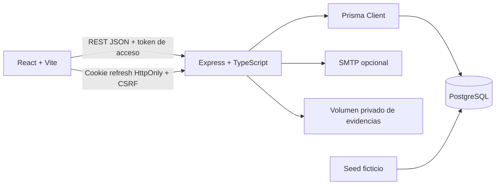
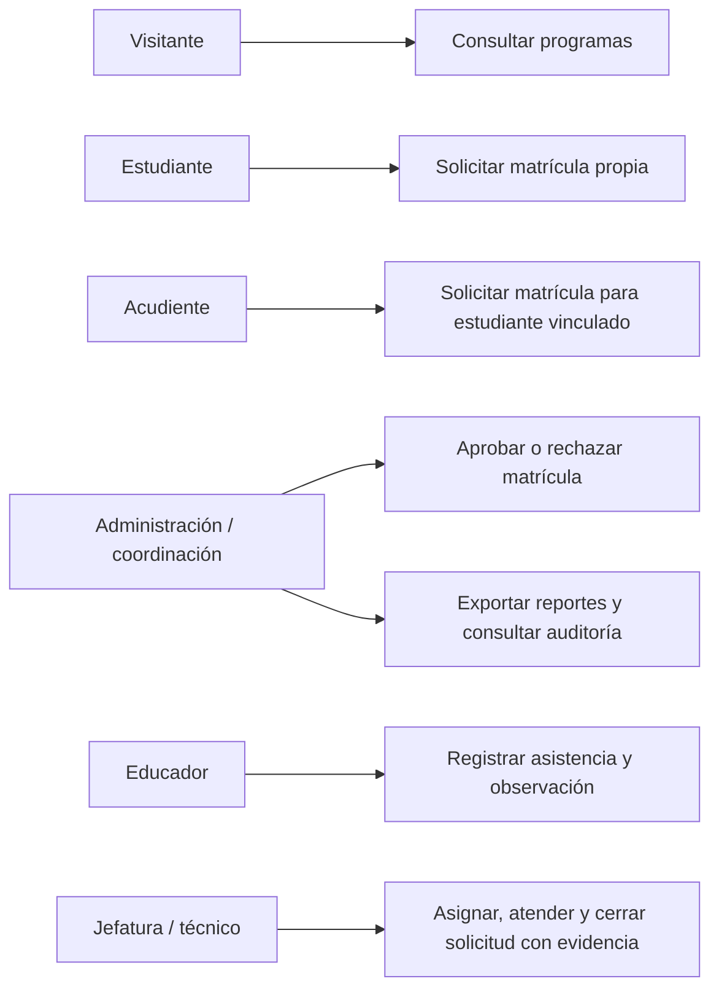

# Arquitectura y decisiones

La separación por componente mantiene interfaz, reglas de aplicación y persistencia desacopladas. `database/prisma/schema.prisma` es la fuente única del modelo; `backend/src/server.ts` expone rutas REST y valida entradas con Zod. Los contadores del panel se consultan a PostgreSQL.

El acceso combina contraseña con hash, JWT de corta duración, refresh rotatorio en cookie HttpOnly, CSRF y controles por rol. MFA TOTP cifra el secreto de recuperación con `MFA_ENCRYPTION_KEY`. Las evidencias se validan al cargar y se recuperan mediante una ruta autenticada.

La dirección visual parte de «El arte como punto de encuentro»: paleta cultural, composición editorial, recursos geométricos CSS y navegación adaptada al rol. No se muestra contenido institucional como real si proviene del seed.

## Flujo principal

## Límites pendientes

No se pudo validar el esquema Prisma ni compilar la aplicación en este entorno por ausencia de dependencias instaladas (el registro npm no resolvió) y Docker. Compose usa `prisma db push` para demostración; falta generar/revisar una migración inicial versionada. Swagger/OpenAPI formal no está publicado. Antes de producción deben configurarse SMTP y almacenamiento privado durable, rotación de secretos, backups y revisión institucional de privacidad.
