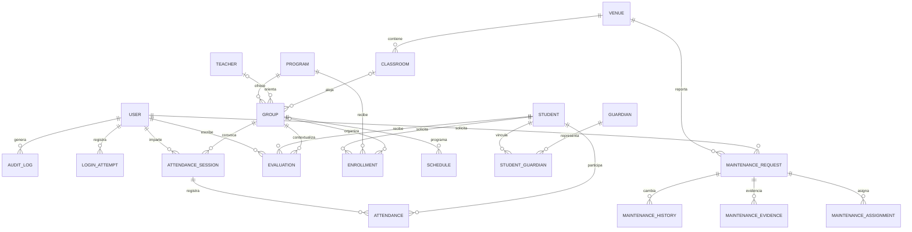

# Modelo entidad-relación

El esquema autoritativo es [`../../database/prisma/schema.prisma`](../../database/prisma/schema.prisma). Este diagrama resume los vínculos principales; auditoría, consentimiento, sesiones de acceso y mantenimiento preventivo también están modelados en Prisma.

Los nombres del diagrama resumen modelos Prisma. Las claves únicas incluyen correo, documento estudiantil, nombre de programa, número de solicitud, sesión por grupo/fecha y asistencia por estudiante/sesión.
